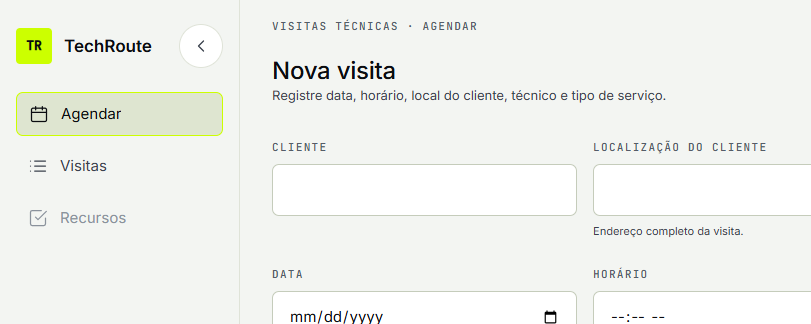
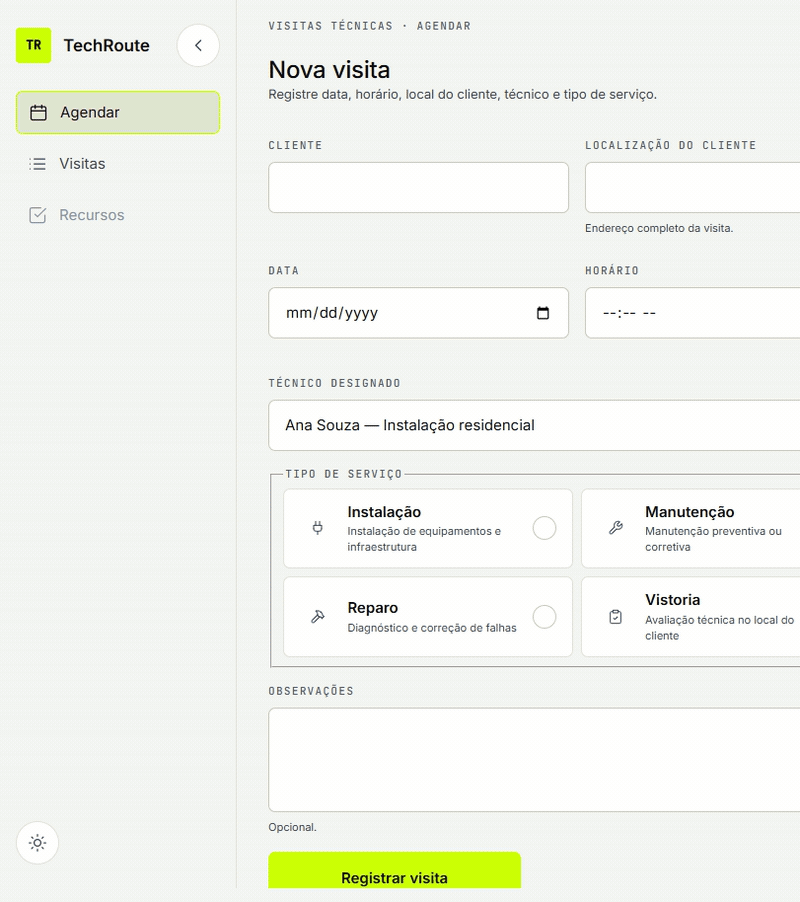
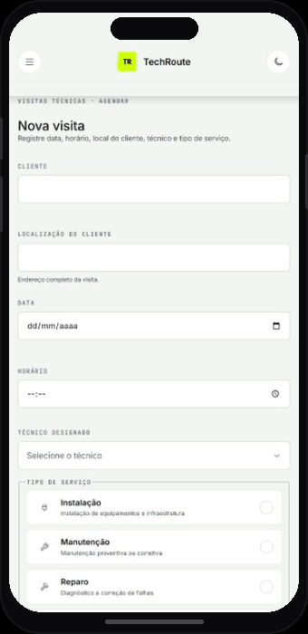
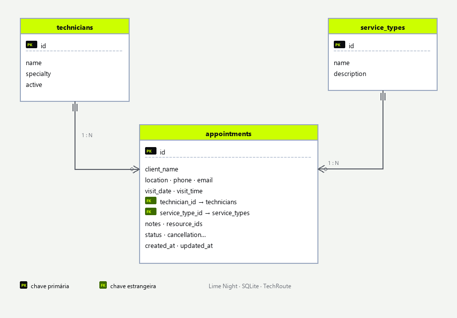

# TechRoute | Aplicativo de Agendamento e Logística Técnica

<p align="center">
  
</p>

<p align="center">
  <strong>Agende visitas técnicas com clareza.</strong><br />
  Data, horário, local, técnico e tipo de serviço — em uma interface responsiva, com tema claro e escuro.
</p>

<p align="center">
  
  
  
  
  
</p>

---

## Sobre o projeto

O **TechRoute** é um aplicativo web para **agendamento de visitas técnicas** e apoio à logística de campo.  
Foi desenvolvido como entrega de estágio, com foco em:

- formulário completo de agendamento;
- listagem e gestão das visitas (status, edição, cancelamento, conclusão);
- interface responsiva (mobile → desktop);
- temas **claro** e **escuro** com a identidade **Lime Night**;
- backend em Node.js com persistência em **SQLite**;
- organização em **Clean Architecture**.

---

## Telas

### 1–2. Agendar visita — desktop (claro / escuro)

<table>
<tr>
<td width="55%" valign="top">

**Tema claro** — formulário principal: cliente, contatos, localização, data, horário, técnico designado, tipo de serviço e observações.

**Tema escuro** — mesma experiência com accent lima, textos legíveis e superfícies escuras.

</td>
<td width="45%" valign="top" align="center">



</td>
</tr>
</table>

### 3. Mobile

<table>
<tr>
<td width="40%" valign="top" align="center">



</td>
<td width="60%" valign="top">

No mobile e tablet (&lt; 1280px), a sidebar some e a navegação passa para um **header fixo** com menu hamburger. O drawer abre por overlay, sem empurrar o conteúdo, e o botão de tema continua acessível no topo.

O formulário de **Nova visita** empilha em coluna única: cliente, contatos, localização, data, horário, técnico, tipo de serviço e observações. Campos e botões respeitam alvos de toque (≥ 44px).

Ao rolar a tela, o fluxo completo fica visível — do preenchimento até o CTA *Registrar visita* e a seção **Agenda**. Layout fluido, sem barra de rolagem horizontal.

</td>
</tr>
</table>

### 4. Visitas registradas

Após o registro, a visita aparece na agenda com tipo de serviço, data/hora, cliente, contatos, local, técnico e **status**.

| Campo do formulário | O que registra |
|---|---|
| Cliente | Nome do cliente |
| Telefone / Telefone 2 | Contatos (principal e secundário) |
| E-mail | Contato digital |
| Localização | Endereço completo da visita |
| Data + Horário | Slot da visita |
| Técnico designado | Responsável em campo |
| Tipo de serviço | Instalação, Manutenção, Reparo ou Vistoria |
| Observações | Notas opcionais |

---

## Funcionalidades

- **Nova visita** com validação de campos obrigatórios e contatos (telefone, telefone secundário, e-mail)  
- **Tipos de serviço** em cards selecionáveis (com ícones)  
- **Select de técnicos** alinhado ao design system  
- **Agenda** com visitas salvas no banco, em modo **card** ou **lista**  
- **Status da visita** — Aberta · Atrasada · Fechada · Cancelada (badges no card/lista)  
- **Ações na visita** — Alterar · Concluir · Cancelar (com motivo)  
- **Filtros** por status e ordenação A–Z / Z–A  
- **Tema claro / escuro** persistido no navegador  
- **Sidebar desktop** expansível / colapsável  
- **Header mobile** fixo + drawer de navegação  
- **Tooltips** do Lime Night (`.ds-tooltip`) em ícones e atalhos — sem `title=""` nativo  
- Layout fluido (mobile-first: 375 → 768 → 1280 → 1920)

---

## Stack

| Camada | Tecnologia |
|---|---|
| Interface | HTML, CSS, JavaScript (ES Modules) |
| Design system | Lime Night (`--ds-*` tokens) |
| API | Node.js + Express |
| Banco | SQLite (`better-sqlite3`) |
| Testes | Node.js Test Runner |
| Arquitetura | Clean Architecture (Core → Application → Infrastructure → API → Presentation) |

---

## Banco de dados

Persistência local em **SQLite** (`better-sqlite3`).  
Arquivo: `data/techroute.db` (criado automaticamente na primeira execução; ignorado no git).  
Schema e seed: `src/infrastructure/data/schema.js` e `seed.js`.

### Visão geral

| Tabela | Papel |
|---|---|
| `technicians` | Catálogo de técnicos (seed) |
| `service_types` | Catálogo de tipos de serviço (seed) |
| `appointments` | Visitas agendadas (entidade principal) |

### Esquema visual (resumo)

<p align="center">
  
</p>

### Cardinalidade

| Relação | Tipo | Regra |
|---|---|---|
| `technicians` → `appointments` | 1:N | Um técnico pode ter várias visitas |
| `service_types` → `appointments` | 1:N | Um tipo classifica várias visitas |
| `appointments` → técnico / tipo | N:1 | Toda visita referencia um técnico e um tipo |

Integridade referencial via `FOREIGN KEY` no schema SQLite.

---

## Como executar

```bash
# 1. Instalar dependências
npm install

# 2. Subir o servidor
npm start

# 3. Abrir no navegador
# http://localhost:3000
```

| Script | Descrição |
|---|---|
| `npm start` | Sobe a API e os arquivos estáticos |
| `npm run dev` | Sobe com `--watch` (reinicia ao salvar) |
| `npm test` | Roda os testes do domínio / casos de uso |

> O banco SQLite é criado automaticamente em `data/techroute.db` na primeira execução, com seed de técnicos e tipos de serviço.

---

## Estrutura do repositório

```text
/
├── public/                 # Interface (HTML, CSS, JS)
├── src/
│   ├── core/               # Entidades, value objects, Result
│   ├── application/        # Casos de uso
│   ├── infrastructure/     # SQLite, schema, seed, repositórios
│   └── api/                # Express, controllers, composition
├── assets/readme/          # Imagens do README
├── tests/                  # Testes automatizados
├── data/                   # Banco local (arquivos .db ignorados no git)
└── package.json
```

---

## Design system

Identidade visual **Lime Night**:

- accent lima `#CCFF00` em CTAs, seleção e marca;
- tema escuro como padrão de produto;
- tema claro com textos/ícones mais escuros para contraste no branco;
- tokens semânticos `--ds-color-*`, tipografia, espaçamento e componentes `.ds-*`;
- **Tooltips:** `.ds-tooltip` + variantes de cor/posição — dicas de UI nunca usam `title=""`.

Catálogo e demo do design system ficam em `docs/design-system/` (quando a pasta de docs estiver disponível no ambiente de desenvolvimento).

---

## Critérios de aceite

- [x] Captura data e horário da visita  
- [x] Captura localização e contatos do cliente  
- [x] Atribui técnico responsável  
- [x] Define tipo de serviço  
- [x] Interface responsiva  
- [x] Persistência das visitas  
- [x] Status, edição, conclusão e cancelamento  
- [x] Filtros e modos card/lista na agenda  
- [x] Tooltips do Design System  

---

## Próximas entregas

- Alocação de recursos (checklist por visita — coluna `resource_ids` já preparada)  
- Evolução da logística / rotas  
- Deploy

---

## Autor

**Aluna:** Angela Leite  

Projeto de estágio — **TechRoute**  
Aplicativo de Agendamento e Logística Técnica

---

## Licença

Uso educacional / estágio. Ajuste a licença conforme a política da instituição ou do repositório.
