# TechRoute | Aplicativo de Agendamento e Logística Técnica

<p align="center">
  
</p>

<p align="center">
  <strong>Agende visitas técnicas com clareza.</strong><br />
  A home é a lista de visitas; inclusão e edição abrem em <strong>modal</strong> — com tema claro e escuro.
</p>

<p align="center">
  
  
  
  
  
  
  
  
  
</p>

---

## Sobre o projeto

O **TechRoute** é um aplicativo web para **agendamento de visitas técnicas** e apoio à logística de campo.  
Foi desenvolvido como entrega de estágio **em etapas**: o repositório evolui de forma contínua; cada tarefa/entregável marca o que já está aceito naquele marco (tag Git).

### Fluxo de inclusão (versão atual)

Nesta versão, a tela inicial é a **agenda de Visitas** (cards ou tabela).  
A **inclusão de dados** (nova visita) e a **edição / visualização** acontecem em um **modal**, sem sair da lista:

1. A home lista as visitas já registradas (acordeão de **Filtros**: cliente, técnico no supervisor, período e status múltiplo; ordenação; modos card/lista).  
2. O botão **+** (Nova visita) abre o formulário em modal.  
3. Visualizar (olho) abre o mesmo modal em modo leitura; a partir dele é possível editar.  
4. No formulário, o **Checklist de recursos** permite marcar materiais, ferramentas e equipamentos da visita.  
5. Cancelar ou **Reagendar** visita também usam modal (motivo obrigatório).  
6. Login por perfil (supervisor/técnico), **Atender** + observações pós-visita, **Funcionários** e **Meu perfil**.  
7. **Painel semanal** (`#painel`) — exclusivo do supervisor: filtros multi-técnico, KPIs, gráficos e calendário.  
8. Visões **semanas** e **mês** (carrossel) na agenda e no painel; clique na visita abre modal de detalhes.

Foco do produto:

- agenda de visitas como home, com inclusão/edição em **modal**;
- formulário completo de agendamento (cliente, contatos, local, data/hora, técnico, tipo de serviço);
- listagem e gestão das visitas (status, visualização, edição, reagendamento, cancelamento, conclusão, atendimento);
- autenticação com perfis, cadastro de funcionários e administração de perfil/senha;
- alocação de recursos (checklist no modal da visita);
- painel semanal com indicadores, gráficos e calendário (supervisor);
- calendário por semanas e por mês (carrossel), com status coloridos e modal de detalhes;
- interface responsiva (mobile → desktop);
- temas **claro** e **escuro** com a identidade **Lime Night**;
- backend em Node.js com persistência em **SQLite**;
- organização em **Clean Architecture**.

---

## Entregáveis

O app pode estar mais avançado no código do que a tarefa oficial do momento.  
A lista abaixo espelha o **painel de entregas do estágio** (4 entregáveis).

### 1. Gerenciamento de Visitas Técnicas

| Tarefa | Descrição | Status | Tag sugerida |
|---|---|---|---|
| **1.1** Implementação do Formulário de Agendamento | Formulário para registrar visitas com data, hora, localização do cliente, técnico designado e tipo de serviço | Submetida | `v1.1` |
| **1.2** Alocação de Recursos | Checklist para seleção de materiais, ferramentas e equipamentos necessários para cada visita | Submetida | `v1.2` |

**Critérios de aceite — 1.1**

- Formulário deve capturar todas as informações necessárias para uma visita  
- A interface do formulário deve ser responsiva  

**Critérios de aceite — 1.2**

- Deve armazenar corretamente os itens selecionados  
- A checklist deve ser fácil de usar  

---

### 2. Gerenciamento de Status de Visita

| Tarefa | Descrição | Status | Tag sugerida |
|---|---|---|---|
| **2.1** Atualização de Status e Motivos | Permitir atualização de status da visita com marcação de tempo, além de motivos/comentários para reagendamento ou cancelamento | Submetida | `v2.1` |

**Critérios de aceite — 2.1**

- Status deve ser atualizado corretamente com marcação de tempo  
- Usuários devem poder adicionar motivos facilmente ao reagendar ou cancelar  

---

### 3. Notas Pós-Visita

| Tarefa | Descrição | Status | Tag sugerida |
|---|---|---|---|
| **3.1** Campo de Observações do Técnico | Campo de texto para o técnico registrar observações após cada visita, com login/perfis, atendimento em campo, administração de usuários e filtros avançados na agenda | Submetida | `v3.1` |

**Critérios de aceite — 3.1**

- Técnicos devem conseguir salvar as observações sem erros  
- Observações devem ser fáceis de visualizar por supervisores  

**Entrega v3.1 (Submetida — aprovação)**

Entregue nesta etapa:

- **Login e perfis** — sessão por cookie; supervisor e técnico com permissões distintas.  
- **Atender** — inicia atendimento (`in_progress`); libera **Observações pós-visita** (layout alinhado ao checklist) com rascunho e conclusão.  
- **Histórico de agendamentos** — acordeão no modal, com autor dos eventos e sem salto de scroll ao abrir.  
- **Funcionários** (`#usuarios`) — cadastro em popup (login, nome, tipo de acesso), ativar/desativar, resetar senha; senha padrão `TechRoute@123`.  
- **Meu perfil** (`#perfil`) — editar nome de exibição e alterar senha.  
- **Filtros da agenda** — acordeão com cliente, técnico (só supervisor), período De/Até e **status com seleção múltipla**.

**Login e perfis (demo)**

| Perfil | Usuário demo | Senha | Acesso |
|---|---|---|---|
| Supervisor | `supervisor` | `123456` | Agenda completa, criar/editar, status, ver notas, cadastro de funcionários |
| Técnico | `ana`, `carlos`, `juliana`, `pedro` | `123456` | Suas visitas, atender, concluir e salvar observações pós-visita |

**Funcionários e perfil**

- Menu **Funcionários** (`#usuarios`): exclusivo do supervisor — cadastra usuários (supervisor/técnico), ativa/desativa e reseta senha.  
- Senha padrão de novos cadastros: `TechRoute@123` (o usuário pode trocar em **Meu perfil**).  
- Menu **Meu perfil** (`#perfil`): disponível para todos — editar nome de exibição e alterar senha.

---

### 4. Painel Semanal

| Tarefa | Descrição | Status | Tag sugerida |
|---|---|---|---|
| **4.1** Sistema de Filtros do Dashboard | Painel exclusivo do supervisor (`#painel`): multi-técnicos, período, status, KPIs e gráficos | Submetida | `v4.1` |
| **4.2** Implementação do Dashboard Calendário | Calendário por semanas e por mês (carrossel) no painel e na agenda; status coloridos; modal ao clicar na visita | Submetida | `v4.2` |

**Critérios de aceite — 4.1**

- Acesso apenas para perfil **supervisor** (técnico não vê o menu nem a rota)  
- Deve ser possível combinar múltiplos filtros (incluindo **vários técnicos**)  
- Dashboard exibe **indicadores (KPIs)** e **gráficos** das visitas filtradas  
- Filtros devem funcionar corretamente e ser intuitivos  

**Entrega v4.1 (Submetida — aprovação)**

Entregue nesta etapa:

- **Painel semanal** (`#painel`) — menu e rota visíveis **somente ao supervisor**.  
- **Filtros combináveis** — um ou mais técnicos, período (De/Até) e status múltiplo; atalhos **Semana atual** / **Próxima semana**.  
- **Indicadores (KPIs)** — total, abertas, em atendimento, atrasadas, remarcadas, fechadas e canceladas.  
- **Gráficos** — visitas por status, carga por técnico e distribuição por dia da semana (Lime Night, CSS nativo).  
- Seed de visitas demo alinhado à semana corrente e à próxima para validar o painel.

**Critérios de aceite — 4.2**

- Indicadores de status coloridos devem estar presentes  
- Deve exibir visitas agendadas de forma clara e organizada  

**Entrega v4.2 (Submetida — aprovação)**

Entregue nesta etapa:

- Toggle **semanas** e **mês** na toolbar de **Visitas** e do **Painel**.  
- **Calendário por semanas** — o período do filtro gera **todas as semanas** (uma linha cada), com chips de visita e badges de status.  
- **Calendário por mês (carrossel)** — um mês por slide, com Anterior/Próximo, pontos e atalhos por nome do mês.  
- **Modal de detalhes** — clique na visita no calendário abre os dados completos (cliente, contatos, data/hora, técnico, serviço, notas, recursos e status).  
- Legenda de status coloridos (aberta/remarcada, atendimento/atrasada, fechada, cancelada).

---

## Telas

### Home = Visitas (lista / cards)

A tela principal é a **agenda**. O botão **+** abre o modal de **Nova visita**; as ações Visualizar / Reagendar / Concluir / Cancelar atuam sobre cada registro.

### 1–2. Modal Nova visita — desktop (claro / escuro)

<table>
<tr>
<td width="55%" valign="top">

O formulário abre em **modal** sobre a agenda: cliente, contatos, localização, data, horário, técnico, tipo de serviço, checklist de recursos e observações.

No tema escuro, a mesma experiência com accent lima e superfícies escuras.

</td>
<td width="45%" valign="top" align="center">


</td>
</tr>
</table>

### 3. Mobile

<table>
<tr>
<td width="40%" valign="top" align="center">


</td>
<td width="60%" valign="top">

No mobile e tablet (&lt; 1280px), a sidebar some e a navegação passa para um **header fixo** com menu hamburger. O drawer abre por overlay.

A home continua sendo a lista de visitas. O modal de **Nova visita** ocupa a tela com formulário em coluna única (alvos de toque ≥ 44px).

Layout fluido, sem barra de rolagem horizontal.

</td>
</tr>
</table>

### 4. Campos do modal (visita)

| Campo do formulário | O que registra |
|---|---|
| Cliente | Nome do cliente |
| Telefone / Telefone 2 | Contatos (principal e secundário) |
| E-mail | Contato digital |
| Localização | Endereço completo da visita |
| Data + Horário | Slot da visita |
| Técnico designado | Responsável em campo |
| Tipo de serviço | Instalação, Manutenção, Reparo ou Vistoria |
| Checklist de recursos | Materiais, ferramentas e equipamentos (opcional) |
| Observações | Notas opcionais |

---

## Funcionalidades

### Login e perfis

Login obrigatório (supervisor / técnico) com sessão em cookie HttpOnly.  
Credenciais demo na própria tela de entrada.

<table>
<tr>
<td width="55%" valign="top">

Perfis distintos: o supervisor vê a agenda completa, funcionários e filtros por técnico; o técnico acessa as próprias visitas, **Atender** e observações pós-visita.

</td>
<td width="45%" valign="top" align="center">

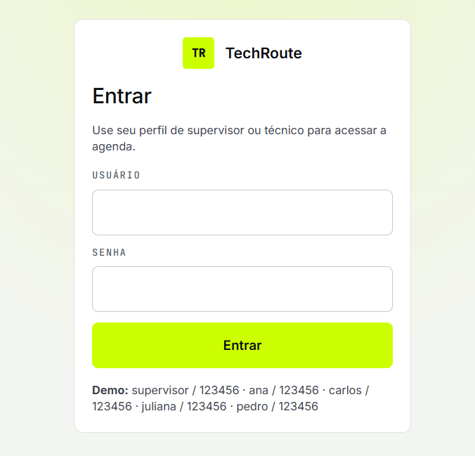

</td>
</tr>
</table>

### Agenda (tela inicial)

- A home do app é a lista de **Visitas**, não uma página separada de formulário.  
- Exibe contador de registros (ou “X de Y” quando há filtro ativo).  
- Empty state quando não há visitas ou quando o filtro não retorna resultados.  
- Alternância entre visão **card** e **lista** (tabela responsiva).  
- Ordenação do cliente **A–Z** / **Z–A**.

<table>
<tr>
<td width="45%" valign="top">

Visão do supervisor: saudação por perfil, lista/tabela de visitas e acordeão de filtros acima da grade.

</td>
<td width="55%" valign="top" align="center">

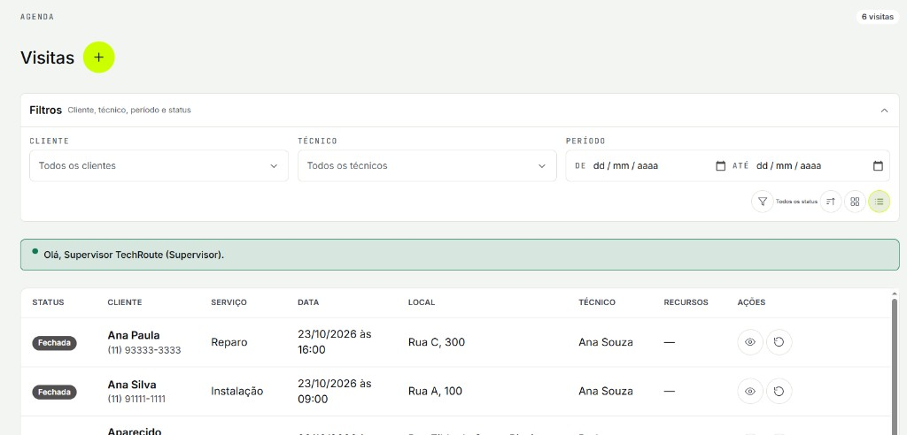

</td>
</tr>
</table>

### Inclusão e edição em modal

- Botão **+ Nova visita** abre o formulário em **modal** sobre a agenda.  
- **Visualizar** abre o mesmo modal em modo leitura; a partir dele é possível **editar**.  
- O modal captura: cliente, telefones, e-mail, localização, data, horário, técnico, tipo de serviço, recursos e observações.  
- Validação de campos obrigatórios e formato de contatos antes de salvar.  
- Persistência imediata na API / SQLite; a lista atualiza ao fechar o modal com sucesso.

### Checklist de recursos

- No modal da visita, seção **Checklist de recursos** (materiais, ferramentas, equipamentos).  
- Itens vindos do catálogo `resources` (seed); seleção múltipla.  
- Vínculos gravados na tabela de junção `appointment_resources` (N:N com FKs).

<p align="center">
  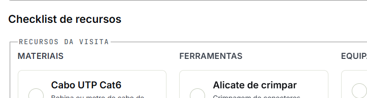
</p>

### Filtros da agenda

- Acordeão **Filtros** abaixo do título Visitas (campos lado a lado no desktop).  
- **Cliente por nome** — dropdown pesquisável: digite para filtrar clientes únicos e selecione um.  
- **Técnico** — apenas na visão do supervisor (“Todos os técnicos” ou técnico específico).  
- **Período** — De / Até na mesma linha; limpar com ícone **X** sem quebrar o layout.  
- **Status** — seleção **múltipla** (Abertas, Em atendimento, Reabertas, Remarcadas, Atrasadas, Fechadas, Canceladas).  
- Filtros combináveis; na visão do técnico a descrição do acordeão omite “técnico”.

<p align="center">
  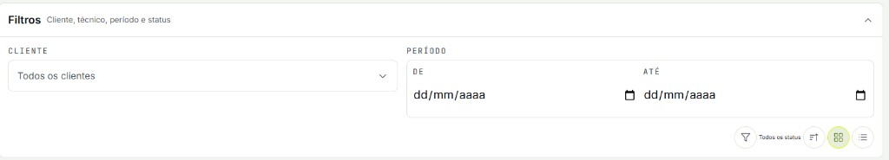
</p>

### Status, Atender e pós-visita

- Status exibido com badges: **Aberta**, **Em atendimento**, **Reaberta**, **Remarcada**, **Atrasada**, **Fechada**, **Cancelada**.  
- **Atender** (técnico da visita) inicia o atendimento e libera as **Observações pós-visita**.  
- **Reagendar** abre modal com nova data/horário e **motivo** obrigatório; o evento entra no histórico.  
- **Concluir** fecha a visita (quando permitido pelo domínio), gravando as notas pós-visita.  
- **Cancelar** abre modal pedindo **motivo**; registra motivo e timestamp.  
- **Reabrir**: visita **cancelada** → status **Remarcada**; visita **fechada** → status **Reaberta** (motivo obrigatório; histórico preservado).  
- Em **Visualizar**, a seção **Histórico de Agendamentos** (acordeão) lista criação, atendimento, reagendamentos, cancelamento, reabertura e conclusão com timestamps e autor.  
- Visitas canceladas também mostram o motivo na listagem em cards.

<table>
<tr>
<td width="50%" valign="top">

Após **Atender**, o técnico registra notas do atendimento (rascunho ou conclusão). Layout alinhado ao checklist de recursos.

</td>
<td width="50%" valign="top" align="center">

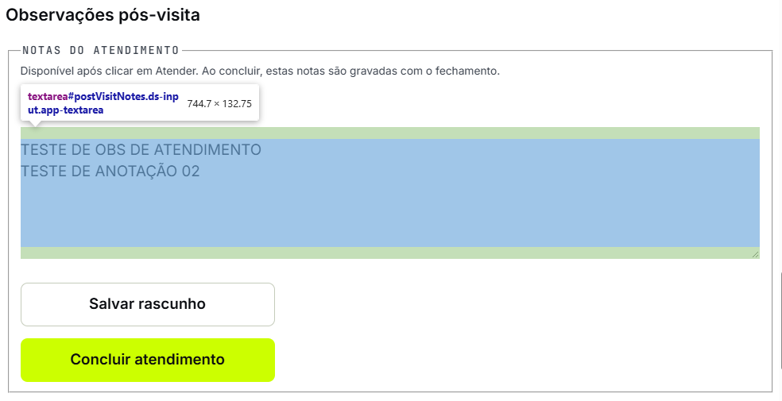

</td>
</tr>
</table>

### Funcionários (supervisor)

- Menu **Funcionários** (`#usuarios`): cadastrar usuários, tipo de acesso, ativar/desativar e resetar senha.  
- Cadastro em popup; senha padrão `TechRoute@123`.

<table>
<tr>
<td width="40%" valign="top">

Cards por funcionário com papel (Supervisor/Técnico), status Ativo e ações Editar / Resetar senha / Desativar.

</td>
<td width="60%" valign="top" align="center">

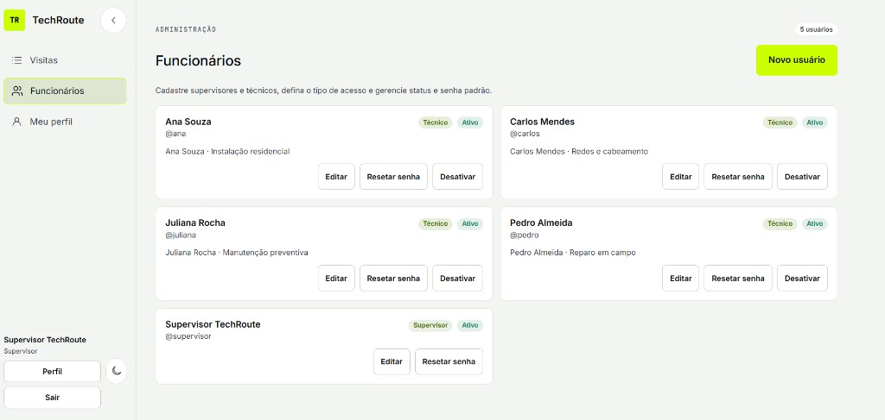

</td>
</tr>
</table>

### Meu perfil

- Disponível para todos: editar nome de exibição e alterar senha.

<table>
<tr>
<td width="40%" valign="top">

Dados do perfil (login e tipo de acesso somente leitura) + bloco para trocar senha.

</td>
<td width="60%" valign="top" align="center">

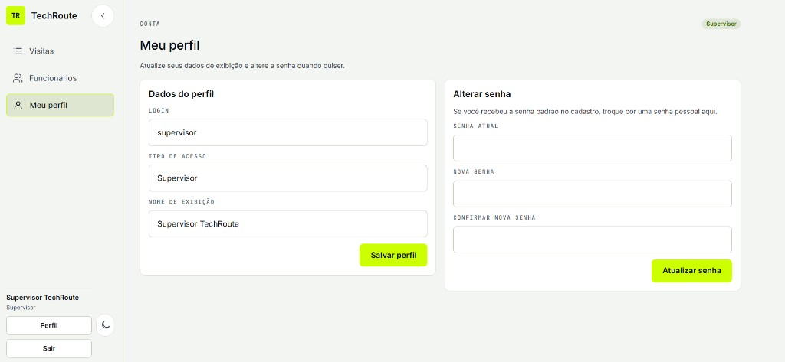

</td>
</tr>
</table>

### Painel semanal (supervisor)

- Menu **Painel** (`#painel`): exclusivo do supervisor — técnico não vê o item nem acessa a rota.  
- Filtros: **um ou mais técnicos**, período De/Até e status múltiplo; atalhos para semana atual e próxima.  
- **KPIs** no topo (total e por status) e **gráficos** de status, carga por técnico e distribuição por dia da semana.  
- Alternância de visão: **indicadores**, **semanas** e **mês** (carrossel).

<p align="center">
  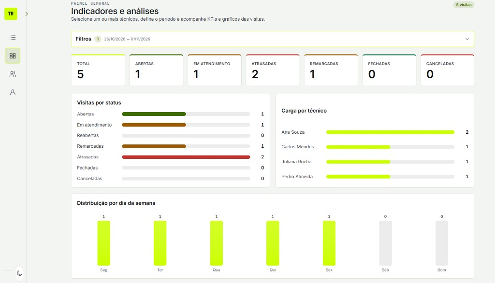
</p>

### Calendário por semanas

- Disponível em **Visitas** e no **Painel**.  
- O intervalo De/Até é dividido em semanas (cada uma em uma linha), com visitas por dia e status coloridos.  
- Clique no chip da visita para abrir a **modal de detalhes**.

<p align="center">
  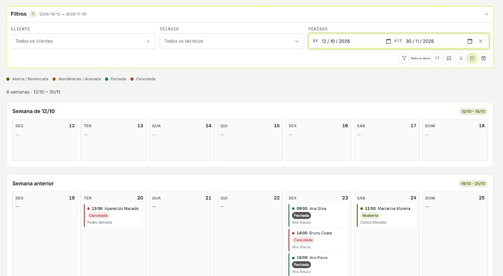
</p>

### Calendário por mês (carrossel)

- Grade mensal completa (seg–dom) com todos os agendamentos do dia.  
- Navegação em **carrossel**: Anterior / Próximo, contador, pontos e chips com o nome do mês.  
- Clique na visita abre a modal de detalhes.

<p align="center">
  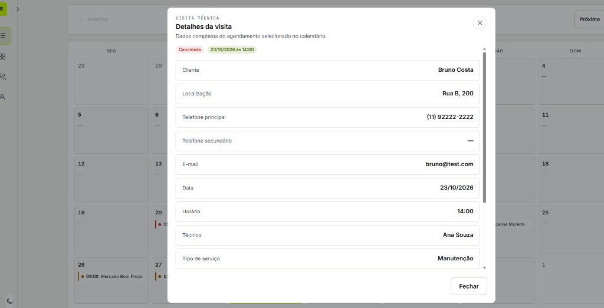
</p>

### Modal de detalhes da visita (calendário)

- Ao clicar em uma visita no calendário (semanas ou mês), abre modal somente leitura com os dados completos: cliente, localização, telefones, e-mail, data/hora, técnico, tipo de serviço, observações, pós-visita, recursos e status.

<table>
<tr>
<td width="45%" valign="top">

Útil para consultar o agendamento sem sair da visão de calendário.

</td>
<td width="55%" valign="top" align="center">

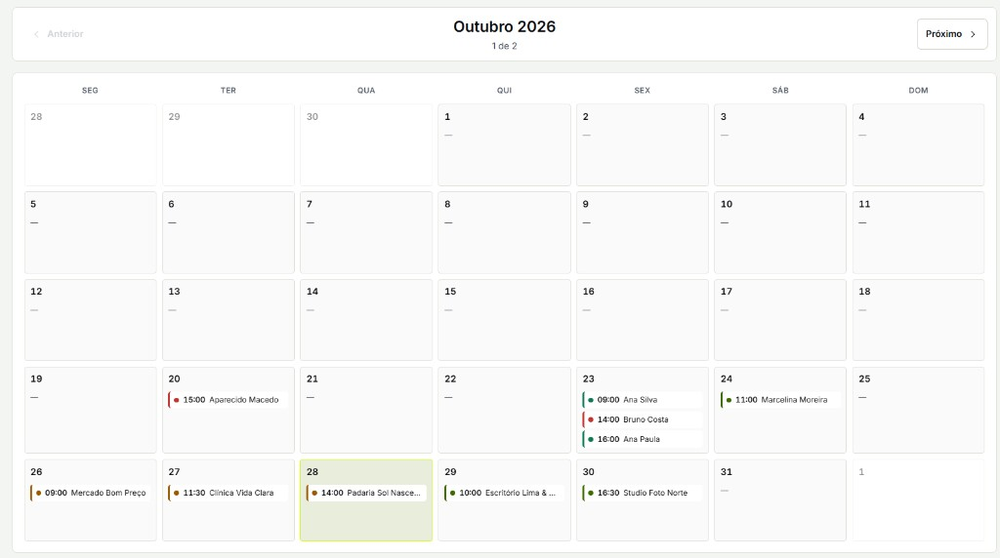

</td>
</tr>
</table>

### Catálogos do formulário

- **Tipos de serviço** em cards selecionáveis com ícones (Instalação, Manutenção, Reparo, Vistoria).  
- **Técnicos** em select alinhado ao design system (apenas ativos do seed/catálogo).

### Interface e experiência

- Temas **claro** e **escuro** (Lime Night), preferência salva no navegador.  
- **Sidebar** no desktop (expansível / colapsável); some no mobile/tablet (&lt; 1280px).  
- **Header mobile** fixo + drawer de navegação por overlay.  
- **Tooltips** do design system (`.ds-tooltip`) em atalhos e ícones — sem `title=""` nativo.  
- Layout fluido mobile-first (375 → 768 → 1280 → 1920), alvos de toque ≥ 44px.

---

## Stack

| Camada | Tecnologia |
|---|---|
| Interface | HTML, CSS, JavaScript (ES Modules) |
| Design system | Lime Night (`--ds-*` tokens) |
| API | Node.js + Express |
| Banco | SQLite (`better-sqlite3`) |
| Testes | Node.js Test Runner |
| Arquitetura | Clean Architecture (Core → Application → Infrastructure → API → Presentation) |

---

## Banco de dados

Persistência local em **SQLite** (`better-sqlite3`).  
Arquivo: `data/techroute.db` (criado automaticamente na primeira execução; ignorado no git).  
Schema e seed: `src/infrastructure/data/schema.js` e `seed.js`.

### Visão geral

| Tabela | Papel |
|---|---|
| `technicians` | Catálogo de técnicos (seed) |
| `service_types` | Catálogo de tipos de serviço (seed) |
| `resources` | Catálogo de materiais, ferramentas e equipamentos (seed) |
| `appointments` | Visitas agendadas (status, atendimento, notas pós-visita) |
| `appointment_resources` | Junção N:N entre visita e recurso (`appointment_id` + `resource_id`) |
| `appointment_events` | Histórico da visita (criação, atender, reagendar, cancelar, reabrir, concluir) |
| `users` | Contas de acesso (supervisor / técnico), vínculo opcional com `technicians` |
| `sessions` | Sessões de login (token HttpOnly + expiração) |

### Esquema visual (resumo)

<p align="center">
  
</p>

### Cardinalidade

| Relação | Tipo | Regra |
|---|---|---|
| `users` → `sessions` | 1:N | Um usuário pode ter várias sessões (`user_id` FK) |
| `technicians` → `users` | 1:0..1 | Usuário técnico pode apontar para um técnico do catálogo |
| `technicians` → `appointments` | 1:N | Um técnico pode ter várias visitas (`technician_id` FK) |
| `service_types` → `appointments` | 1:N | Um tipo classifica várias visitas (`service_type_id` FK) |
| `appointments` → `appointment_events` | 1:N | Uma visita tem vários eventos de histórico |
| `appointments` → `appointment_resources` | 1:N | Uma visita pode ter vários vínculos de recurso |
| `resources` → `appointment_resources` | 1:N | Um recurso pode estar em várias visitas |
| `resources` ↔ `appointments` | N:N | Via tabela de junção `appointment_resources` (FKs + PK composta) |

Integridade referencial via `FOREIGN KEY` no SQLite (usuário↔sessão, técnico, tipo, visita↔evento/recurso).

---

## Como executar

```bash
# 1. Instalar dependências
npm install

# 2. Subir o servidor
npm start

# 3. Abrir no navegador
# http://localhost:3000
```

| Script | Descrição |
|---|---|
| `npm start` | Sobe a API e os arquivos estáticos |
| `npm run dev` | Sobe com `--watch` (reinicia ao salvar) |
| `npm test` | Roda os testes do domínio / casos de uso |

> O banco SQLite é criado automaticamente em `data/techroute.db` na primeira execução, com seed de técnicos, tipos de serviço, recursos e usuários demo.

---

## Estrutura do repositório

```text
/
├── public/                              # Interface (HTML, CSS, JS)
│   ├── css/layout.css
│   ├── design-system/                   # Tokens e componentes Lime Night
│   ├── index.html
│   └── js/
│       ├── api/                         # http, auth, appointments, catalog, users
│       ├── components/                  # app-shell, field, banner, week-calendar, ícones
│       └── pages/                       # schedule-form, weekly-dashboard, users-admin, profile
├── src/
│   ├── core/
│   │   ├── entities/                    # Appointment, AppointmentEvent, Technician…
│   │   ├── value-objects/               # VisitStatus, VisitSlot, Phone, Email…
│   │   ├── repositories/contracts.js
│   │   └── common/Result.js
│   ├── application/
│   │   ├── services/                    # Login, Atender, Close, Users, List…
│   │   ├── common/                      # actor, defaultPassword
│   │   ├── input-models/
│   │   └── view-models/
│   ├── infrastructure/
│   │   ├── data/                        # connection, schema, seed
│   │   ├── repositories/                # SqliteAppointment/User/Session…
│   │   └── security/password.js
│   └── api/                             # Express, middleware auth, controllers
├── tests/                               # Domínio e casos de uso (Login, Atender…)
├── assets/readme/                       # Imagens do README publicado
├── data/                                # Banco local (.db ignorado no git)
└── package.json
```

---

## Design system

Identidade visual **Lime Night**:

- accent lima `#CCFF00` em CTAs, seleção e marca;
- tema escuro como padrão de produto;
- tema claro com textos/ícones mais escuros para contraste no branco;
- tokens semânticos `--ds-color-*`, tipografia, espaçamento e componentes `.ds-*`;
- **Tooltips:** `.ds-tooltip` + variantes de cor/posição — dicas de UI nunca usam `title=""`.

Catálogo e demo do design system ficam em `docs/design-system/` (quando a pasta de docs estiver disponível no ambiente de desenvolvimento).

---

## Autor

**Aluna:** Angela Leite  

Projeto de estágio — **TechRoute**  
Aplicativo de Agendamento e Logística Técnica

---

## Licença

Uso educacional / estágio. Ajuste a licença conforme a política da instituição ou do repositório.
